<div align="center">

# ⚡ RUNIX Database Studio

**Modern, Cross-Platform (macOS, Linux & Windows), High-Performance Relational Database Studio**  
*Built natively with .NET 10, C# 13, Avalonia UI 11 & SkiaSharp — Zero Electron overhead, 100% offline & privacy-first.*

[](#)
[](#)
[](https://dotnet.microsoft.com/)
[](https://learn.microsoft.com/en-us/dotnet/csharp/)
[](https://avaloniaui.net/)
[](https://www.postgresql.org/)
[](https://www.sqlite.org/)
[](https://www.mysql.com/)
[](https://mariadb.org/)
[](https://www.microsoft.com/sql-server)
[](https://github.com/juniorschroder/vard)
[](#-testing--headless-verification)

<p align="center">
  <strong>🇺🇸 English</strong> • <a href="README.pt-BR.md">🇧🇷 Português (Brasil)</a>
</p>

</div>

---

## 📖 Overview

**RUNIX Database Studio** is a fast, modern, and resilient **cross-platform desktop client (running natively on macOS, Linux, and Windows)** for inspecting, querying, administering, generating test data, and visually modeling relational databases (**PostgreSQL**, **SQLite**, **MySQL**, **MariaDB**, and **Microsoft SQL Server**).

Engineered with strict **Clean Architecture** and natively rendered via **Avalonia UI** and **SkiaSharp**, RUNIX delivers instant startup, low memory footprint, transient network fault tolerance powered by [**Vard**](https://github.com/juniorschroder/vard) (Exponential Backoff Retry & Circuit Breaker), military-grade **AES-256-GCM** encryption for credentials and shareable bundles (`.rcf`), drag-and-drop connection categories, and real-time bilingual support (**English `en-US`** and **Portuguese `pt-BR`**).

---

## ✨ Key Features

### 🔌 Multi-Engine Connectivity, Security & Resilience
- **Multi-Engine Relational Support:** High-performance native drivers for **PostgreSQL** (`Npgsql`), **SQLite** (`Microsoft.Data.Sqlite`), **MySQL** (`MySqlConnector`), **MariaDB** (`MySqlConnector`), and **Microsoft SQL Server** (`Microsoft.Data.SqlClient`), including a built-in demonstration database (`demo.db`).
- **Modern Engine Dropdown Selector:** Streamlined engine switcher featuring official vector brand logos, automatic default port configuration (`5432`, `3306`, `1433`), dialect-specific options (e.g. *Trust Server Certificate* for SQL Server, *SSL Mode* for PostgreSQL), and local file browser for SQLite.
- **Hierarchical Connection Categories:** Organize saved profiles in collapsible folders with drag-and-drop reordering, inline category management, and environment badges (Production `🚨 PROD`, Read-Only `🔒 RO`, SSH Tunnel `🔐 SSH`).
- **AES-256-GCM Credential Vault:** Database passwords, SSH credentials, and private key passphrases are encrypted at rest (`AesGcm` + `PBKDF2-SHA256` key derivation with 100,000 iterations).
- **Encrypted Shareable Bundles (`.rcf`):** Export and import connections, saved queries, and custom snippets into a master-password-protected `.rcf` bundle for secure team sharing or machine migration.
- **Built-in SSH Tunneling:** Native SSH port forwarding over ephemeral local ports (`127.0.0.1:0`) supporting both password and private key authentication (`.pem`, `id_rsa`, `id_ed25519`).
- **Resilience with [Vard](https://github.com/juniorschroder/vard):** Dedicated `ResilientDatabaseService` layer with automatic *Exponential Backoff Retry* and *Circuit Breaker* policies across all network database engines, preventing UI freezes or lost tabs during transient network drops.

### 💻 Advanced SQL Editor, Autocomplete & Visual Query Builder
- **Contextual IntelliSense & Autocomplete (`< 2ms`):** In-process lexical analyzer (`SqlLexerService`) suggesting ANSI SQL keywords, tables, views, alias-resolved columns (`FROM cheeses c` -> `c.`), and custom snippets (`[KW]`, `[TBL]`, `[COL]`, `[SNP]`).
- **In-Process SQL Beautifier (`Ctrl+Shift+F`):** Lexical SQL formatter that indents complex queries while preserving string literals `'...'`, quoted identifiers `"..."`, comments, and dollar-quoted blocks (`$$...$$`).
- **Visual Query Builder:** Interactive point-and-click query builder featuring table/column selection, aggregate functions (`SUM`, `COUNT`, `AVG`, `MIN`, `MAX`), automatic Foreign Key `JOIN` suggestions, `WHERE` filters, and `ORDER BY` clauses.
- **Query Library & Snippet Manager:** Persistent local repository for favorite queries (with tags and search) and reusable SQL snippets.

### 🎲 Mock Data Generator (Test Data Seeding)
- **Smart Schema-Aware Synthesis:** Intelligently infers generation rules based on column data types and naming conventions (names, emails, phones, addresses, timestamps, integer sequences, random decimals, and custom formats).
- **Foreign Key Sampling:** Automatically inspects and samples valid parent IDs from related tables to maintain strict referential integrity (`FOREIGN KEY`) without constraint violations.
- **Configurable Quantities & Nullability:** Select from preset batch sizes (10, 25, **50 default**, 100, 250, 500, 1,000 rows) and adjust per-column null percentages.
- **Instant Preview & Direct Seeding:** Real-time 5-row preview grid for instant validation, followed by direct transactional seeding into the database or export to atomic `INSERT INTO` SQL scripts.

### 📐 Bidirectional Visual ERD (Entity-Relationship Diagram) Editor
- **Visual Modeling & Introspection:** Interactive canvas rendering Bezier relationship curves, cardinality badges (`1:N`), primary (`PK`) and foreign (`FK`) keys, zoom, pan, and auto-layout.
- **Entity Search (`Ctrl+F`):** Real-time entity search bar to quickly locate and highlight tables in complex database schemas.
- **DDL Synchronization & Safe Migrations:** Visually create or modify tables, columns, and foreign keys directly on the diagram, preview the generated DDL script (`CREATE TABLE`, `ALTER TABLE`), and apply migrations inside an atomic transaction with automatic rollback on failure.
- **Multi-Format Visual Export:** Export diagrams as high-resolution **PNG** (Retina 2x), standalone **PDF** documents (Fit to Diagram, A4 Landscape, A3 Landscape), or raw **SQL DDL** scripts.

### 🗃️ Database Object Inspector & Editor
- **Dedicated Object Management:** Specialized inspector and DDL editor for non-table schema objects:
  - **Views:** Definition SQL, column metadata, and recreation scripts.
  - **Triggers:** Timing (`BEFORE`, `AFTER`, `INSTEAD OF`), events (`INSERT`, `UPDATE`, `DELETE`), and execution bodies.
  - **Indexes:** Index types (Clustered, Non-Clustered, Unique), column order, and generation DDL.
  - **Functions & Stored Procedures:** Parameter definitions, return types, language dialect, and routine source code.

### 📝 In-Grid Data Editing (Stage / Commit) & Record Inspector
- **Transactional Editing with Dirty Tracking:** Edit cells directly in the `DataGrid`, insert new rows, or mark records for deletion with semantic color coding (Amber for edits, Emerald Green for insertions, Red for deletions).
- **Atomic Preview & Commit:** Review all pending mutations in the staging bar and commit them in a single parameterized transaction with full SQL Injection protection, or discard changes instantaneously in memory.
- **Record Inspector Drawer (`JSON` / `TEXT` / `BLOB`):** Side drawer for inspecting and editing large payloads with JSON Pretty-Print/Minify, multi-line text viewing, and binary Hex Dump (`BLOB`).

### 🔍 Global Command Palette (`Ctrl/Cmd+K`) & Full-Database Search
- **Command Palette (`Ctrl/Cmd+K` / `Ctrl/Cmd+P`):** Instant fuzzy switcher across tables, views, triggers, functions, indexes, saved queries, snippets, and workspace actions, supporting scope prefixes (`>`, `#`, `@`, `?`), acronym matching, and MRU history.
- **Full-Database Data Search:** Asynchronous cross-table data search with safe cancellation, per-table match counters, and one-click jump to filtered table rows.

### 📊 Visual Explain Plan, Quick Charts & DBA Suite
- **Visual Explain Plan & Profiler:** Visual execution plan tree for PostgreSQL (`EXPLAIN (ANALYZE, BUFFERS, FORMAT JSON)`) and SQLite (`EXPLAIN QUERY PLAN`), featuring cost heatmaps and a heuristic index recommendation engine (`CREATE INDEX`).
- **Native SkiaSharp Quick Charts:** Turn any query result into **Vertical Bar**, **Horizontal Bar**, **Line/Area**, **Scatter**, or **Donut/Pie** charts with automatic aggregation and **Retina 2x PNG** / **SVG** export.
- **Schema Compare & Diff Tool:** Side-by-side structural comparison between live databases or schema snapshots, generating safe DDL synchronization scripts.
- **Database Health Dashboard & Assisted Maintenance:** Real-time storage and performance telemetry (Cache Hit Ratio, table vs. index size, Dead Tuples, SQLite pages/freelist), duplicate/unused index detection, and assisted execution of `VACUUM`, `ANALYZE`, `REINDEX`, and `PRAGMA integrity_check`.
- **PostgreSQL Administration:** Visual Role/User Manager, Privilege Matrix (`GRANT`/`REVOKE`), and Live Session Monitor (`pg_stat_activity` with `pg_terminate_backend`).
- **Import, Export & Backup/Restore:** Streaming export to **CSV**, **JSON**, **Excel (`.xlsx`)**, and **SQL Dump**; 3-step Import Wizard with smart column auto-mapping; and native Backup/Restore (`.sql`, `.sql.gz`, `.db`) with topological Foreign Key ordering.

---

## 🖼️ Screenshots

### Main Workspace & Hierarchical Schema Tree
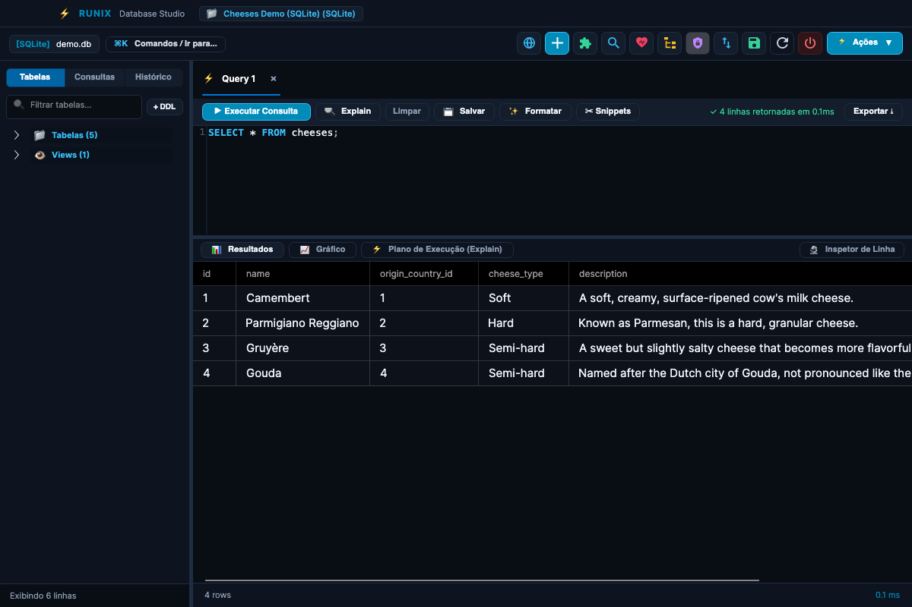

### Connection Manager (PostgreSQL, SQLite, MySQL, MariaDB, SQL Server & `.rcf` Bundles)
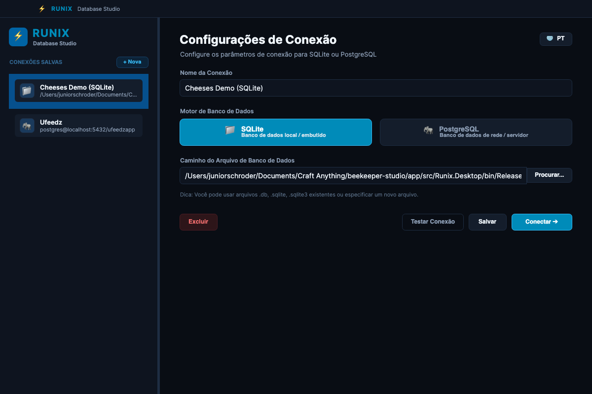

### Interactive Entity-Relationship Diagram (ERD) & Visual Modeling
| Full ERD Diagram | Visual Table Modeling on Canvas |
| :---: | :---: |
| 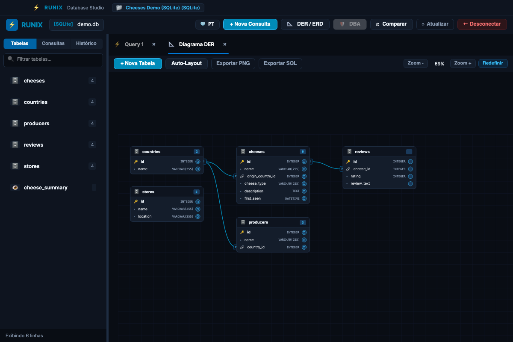 | 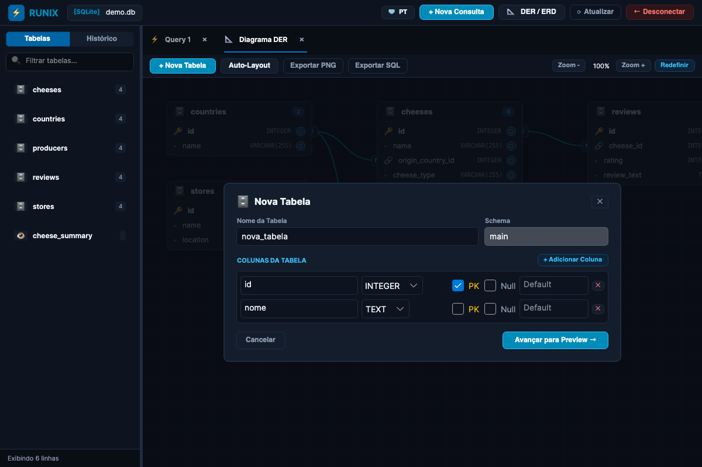 |

| DDL Migration Preview in ERD | Schema Compare (Diff & Sync Tool) |
| :---: | :---: |
| 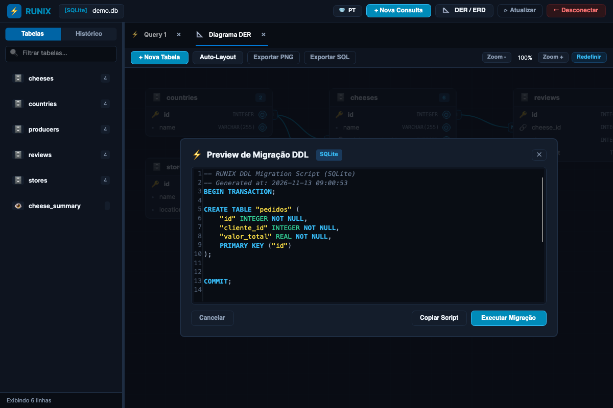 | 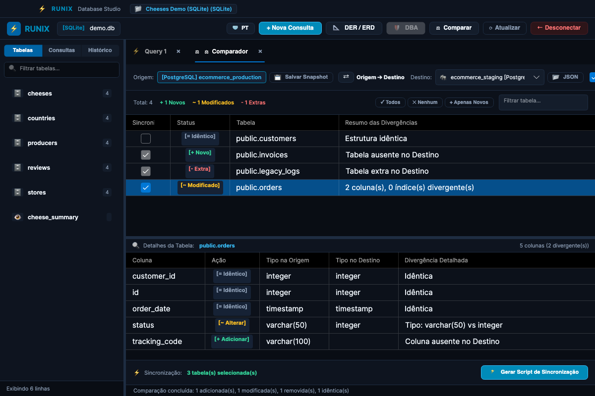 |

### SQL Productivity, In-Grid Editing & Native Charts
| Contextual SQL Autocomplete (`IntelliSense`) | In-Grid Editing with Staging (`Dirty Tracking`) |
| :---: | :---: |
| 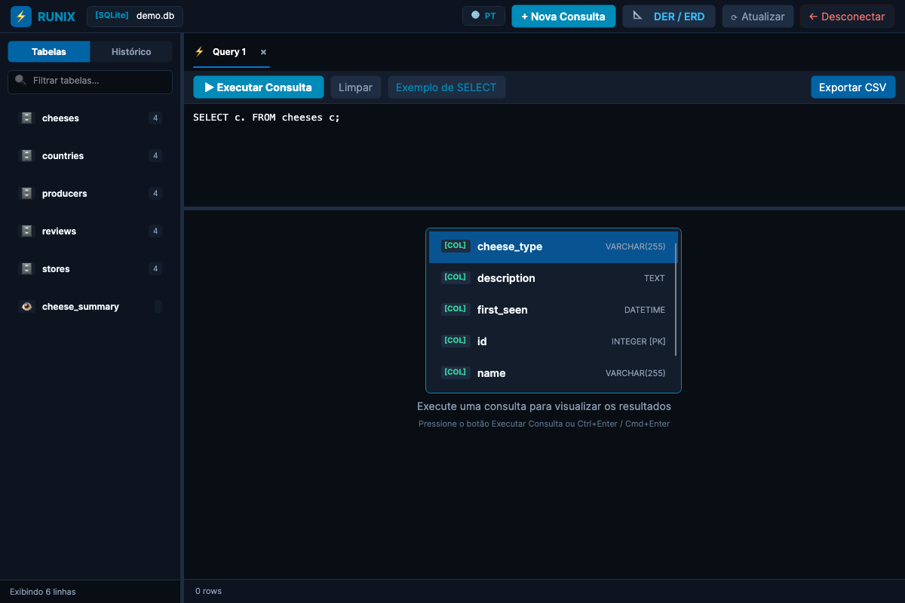 | 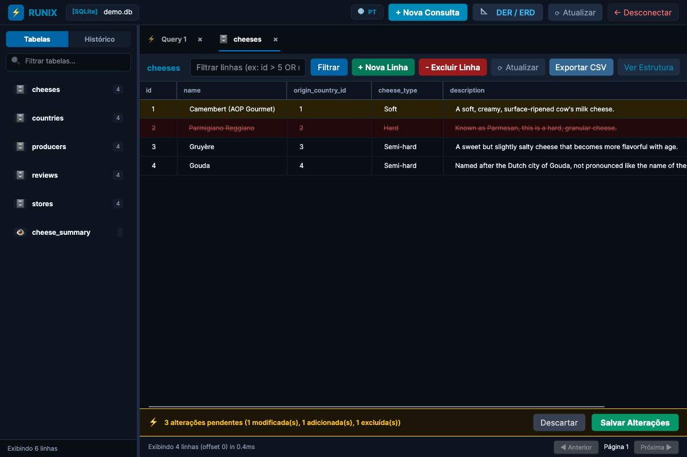 |

| Native SkiaSharp Charts (`Quick Charts`) | Visual Explain Plan & Index Recommendations |
| :---: | :---: |
| 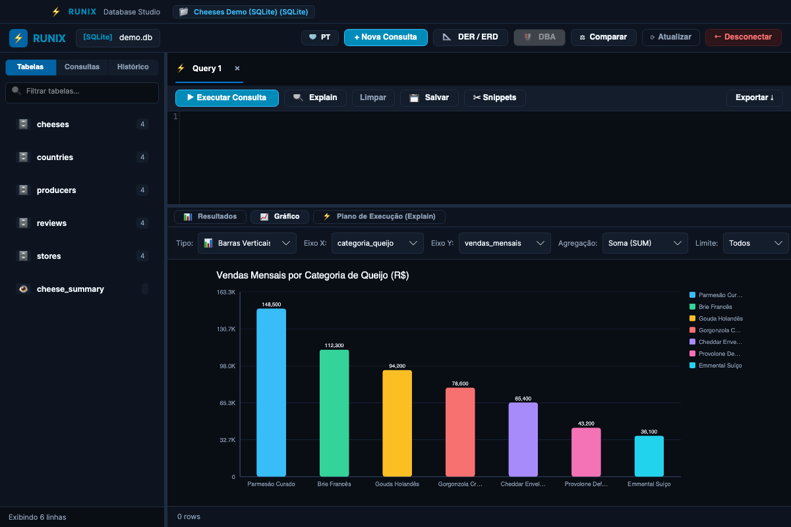 | 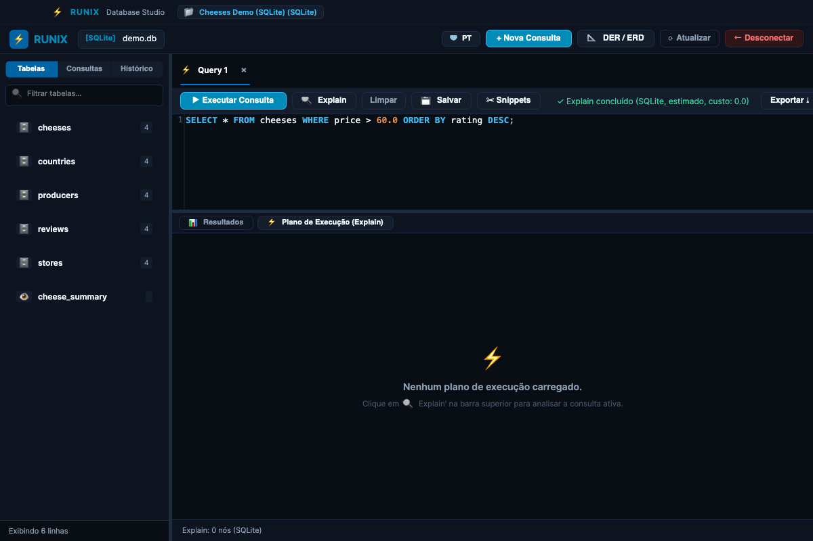 |

### DBA Administration, Import & Export
| PostgreSQL Administration Suite (Roles, Privileges & Sessions) | CSV/Excel Import Wizard |
| :---: | :---: |
| 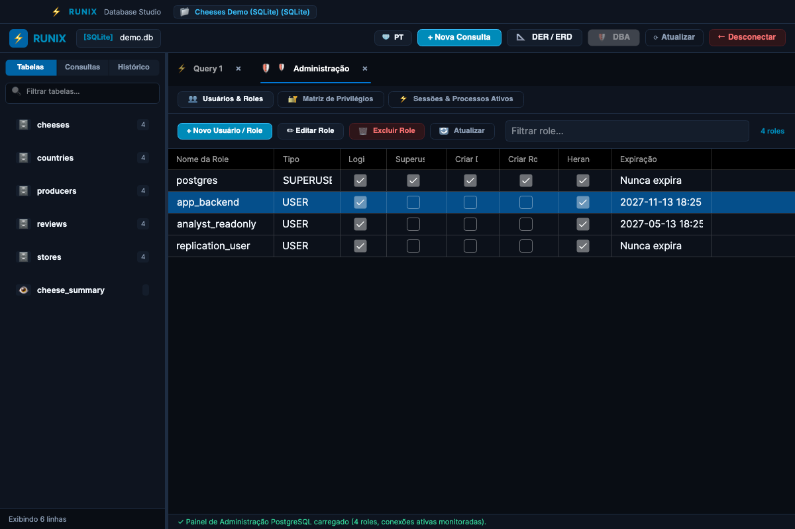 | 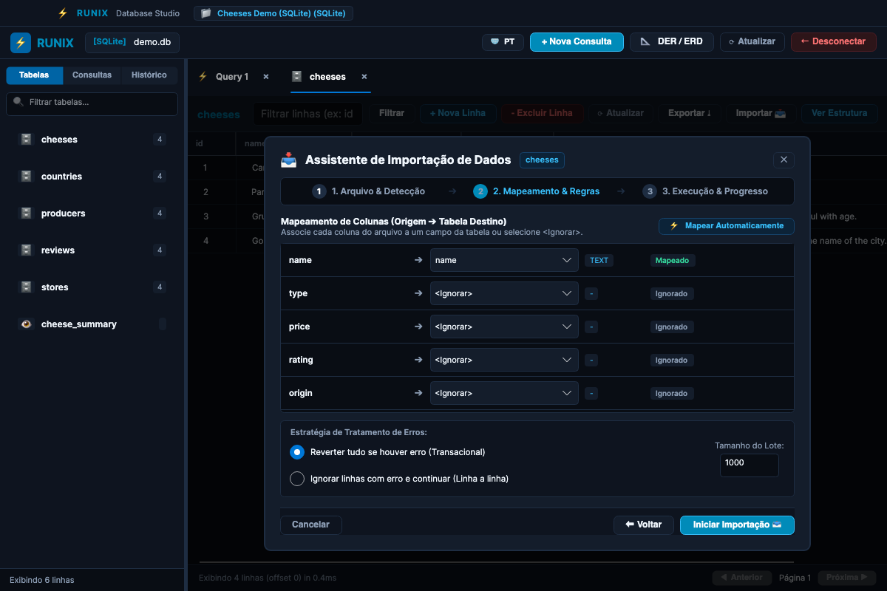 |

| Multi-Format Exporter (CSV, JSON, XLSX, SQL) | Saved Query Library & Execution History |
| :---: | :---: |
| 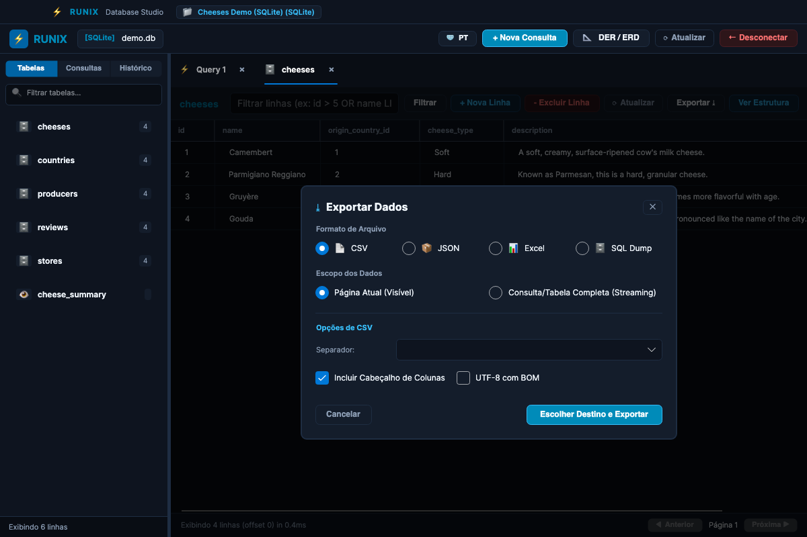 | 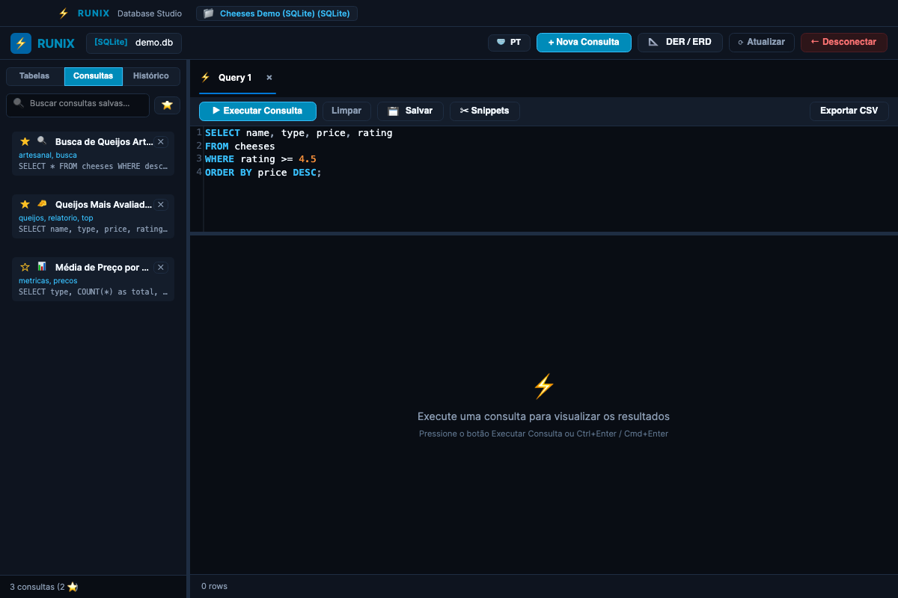 |

---

## 🏗️ Project Architecture

RUNIX strictly follows **Clean Architecture** principles, ensuring separation of concerns, isolated testability, and unidirectional dependencies pointing inward toward the domain (`Runix.Desktop -> Runix.Infrastructure -> Runix.Core`).

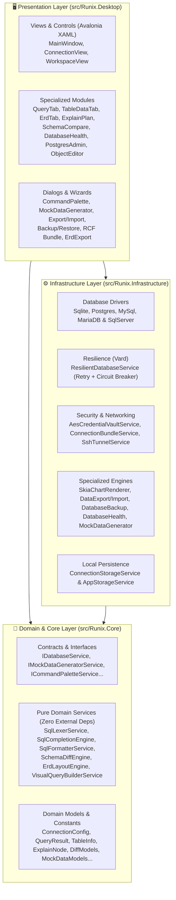

### Directory Structure

```text
├── Runix.sln                          # Main Solution (.NET 10)
├── src/
│   ├── Runix.Core/                    # Pure Domain: Models, Interfaces, SQL Lexer, Diff Engine, ERD Layout, Mock Data Models
│   ├── Runix.Infrastructure/          # Implementations: SQLite, PostgreSQL, MySQL, MariaDB, SQL Server, Vard Resilience, AES-256-GCM, SkiaSharp, MiniExcel
│   └── Runix.Desktop/                 # Avalonia UI 11.1 Desktop App, XAML Views, Themes & Localization (en-US / pt-BR)
├── tests/
│   ├── Runix.Core.Tests/              # Unit tests for domain models, parsers, formatters, and calculation engines (305 tests)
│   └── Runix.Infrastructure.Tests/    # Integration tests for drivers, encryption, backup/restore, import/export, and resilience (182 tests)
└── Screenshots/                       # Screenshots rendered via Headless Skia pipeline
```

---

## 🛠️ Tech Stack

| Category | Technology | Version | Role in RUNIX |
| :--- | :--- | :--- | :--- |
| **Language & Runtime** | **C# 13 / .NET** | `10.0` | Cross-platform runtime (`osx-arm64`, `osx-x64`, `linux-x64`, `win-x64`) |
| **UI Framework** | **Avalonia UI** | `11.1.0` | Native cross-platform UI toolkit with compiled XAML bindings and Fluent Dark theme |
| **Code Editor** | **AvaloniaEdit** | `11.1.0` | High-performance text editor with custom SQL syntax highlighting (`.xshd`) |
| **2D Graphics & PDF Engine** | **SkiaSharp** | `2.88.8` | Vector rendering for analytical charts, ERD canvas, PDF export, and headless frame capture |
| **PostgreSQL Driver** | **Npgsql** | `10.0.3` | High-performance asynchronous ADO.NET data provider for PostgreSQL |
| **SQLite Driver** | **Microsoft.Data.Sqlite** | `11.0.0` | ADO.NET provider for local SQLite databases and internal app storage |
| **MySQL & MariaDB Driver** | **MySqlConnector** | `2.4.0` | Async ADO.NET data provider supporting MySQL and MariaDB protocol features |
| **SQL Server Driver** | **Microsoft.Data.SqlClient** | `6.0.2` | Official Microsoft ADO.NET provider for SQL Server and Azure SQL |
| **Resilience** | [**Vard**](https://github.com/juniorschroder/vard) | `1.0.0` | Transient fault-tolerance policies (*Exponential Backoff Retry* and *Circuit Breaker*) |
| **Excel Spreadsheets** | **MiniExcel** | `1.47.0` | Low-memory streaming reader and writer for `.xlsx` files |
| **Cryptography** | **System.Security.Cryptography** | Native | `AesGcm` (256-bit) + `Rfc2898DeriveBytes.Pbkdf2` (SHA-256) for vault and `.rcf` bundles |
| **Testing** | **xUnit + FluentAssertions** | `2.9.x` | Automated test suite with **487 passing unit and integration tests** |

---

## 🚀 Getting Started

### Prerequisites
- [.NET 10.0 SDK](https://dotnet.microsoft.com/download/dotnet/10.0) installed (macOS, Linux, or Windows).

### 1. Clone & Build
```bash
git clone https://github.com/juniorschroder/runix.git
cd runix

dotnet build Runix.sln
```

### 2. Run the Application
```bash
# Start on the Connection Manager screen
dotnet run --project src/Runix.Desktop/Runix.Desktop.csproj

# Or start connected directly to the built-in SQLite demo database (demo.db)
dotnet run --project src/Runix.Desktop/Runix.Desktop.csproj -- --demo
```

### 3. Publish Standalone Executable (Release)
```bash
dotnet publish src/Runix.Desktop/Runix.Desktop.csproj -c Release -o ./publish
```

---

## 🧪 Testing & Headless Verification

RUNIX includes **487 automated tests** (split across `Runix.Core.Tests` and `Runix.Infrastructure.Tests`) validating everything from SQL lexing and DDL migrations to multi-engine drivers, fake data generation, AES-256-GCM encryption, and the [Vard](https://github.com/juniorschroder/vard) resilience pipeline:

```bash
dotnet test Runix.sln
```

Additionally, the application features a **Headless Skia** rendering mode (`Avalonia.Headless`), enabling real UI screenshot capture in CI/CD pipelines or terminal environments without an active display server:

```bash
dotnet run --project src/Runix.Desktop/Runix.Desktop.csproj -- --demo --screenshot ./Screenshots/preview.png
```

---

## ⌨️ Keyboard Shortcuts

| Shortcut | Action |
| :--- | :--- |
| `Ctrl+K` / `Cmd+K` or `Ctrl+P` / `Cmd+P` | Open the **Global Command Palette** (fuzzy search across tables, views, actions, and queries) |
| `Ctrl+Enter` / `Cmd+Enter` or `F5` | Execute the SQL query in the active tab |
| `Ctrl+Shift+F` | Format and indent SQL code automatically (**SQL Beautifier**) |
| `Ctrl+Space` | Force open the **SQL Autocomplete / IntelliSense** popup |
| `Ctrl+F` | Find in table data / Filter entities in active ERD diagram |
| `Esc` | Dismiss autocomplete popups, modal dialogs, or side drawers |

---

## 👨‍💻 Creator & Author

Created and architected by **José Carlos Schröder Júnior**.

## 📄 License

Distributed under the GNU General Public License v3.0 (GPL-3.0). See the [LICENSE](LICENSE) file for more information.
