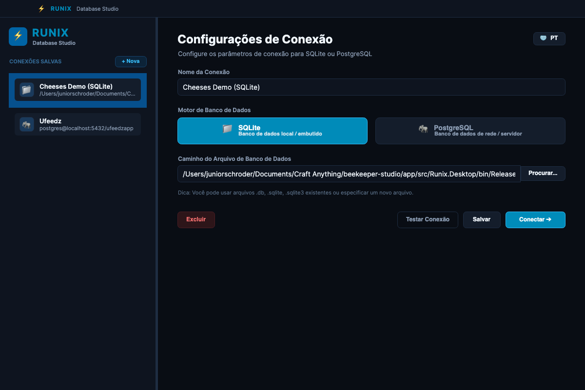
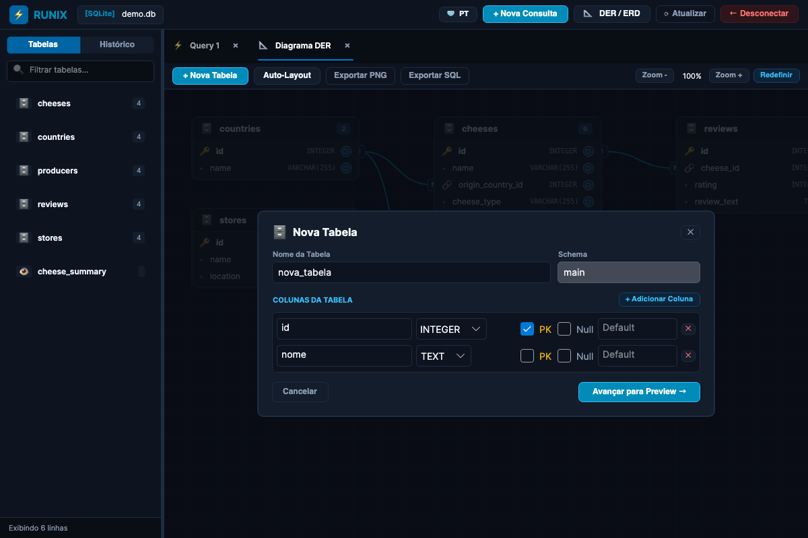
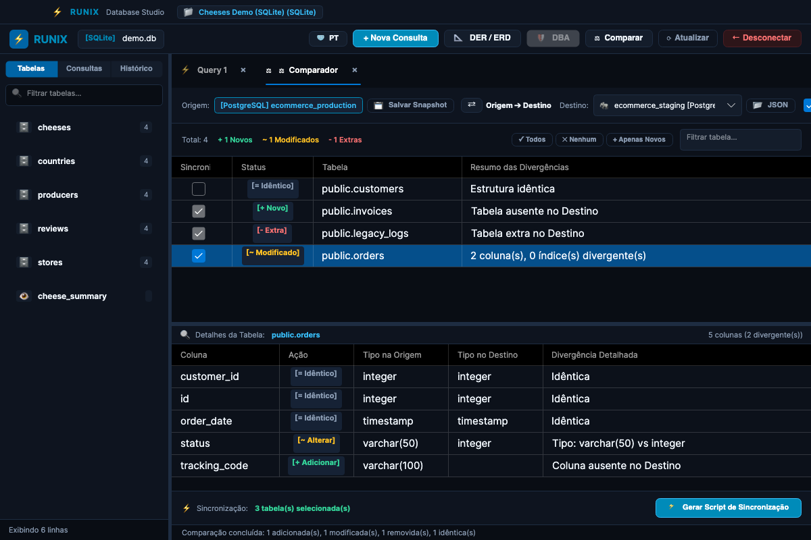
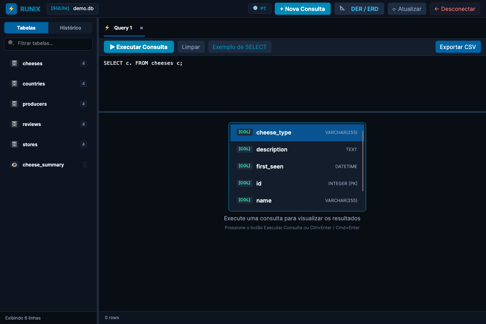
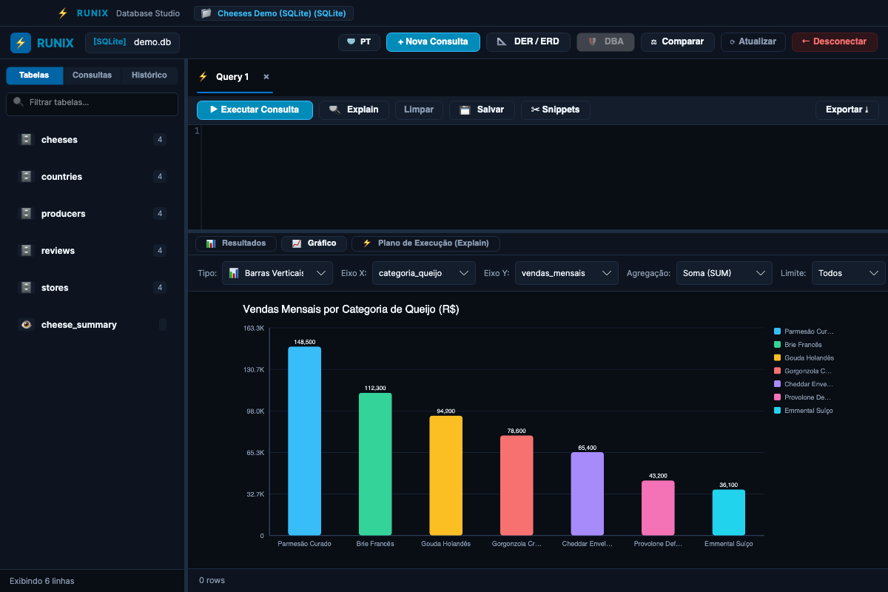
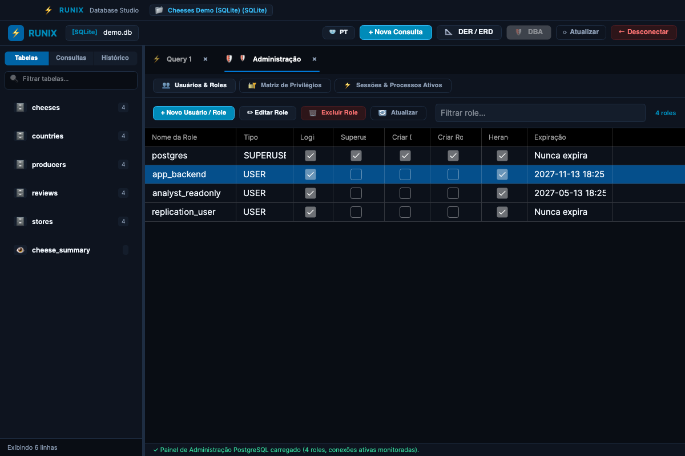
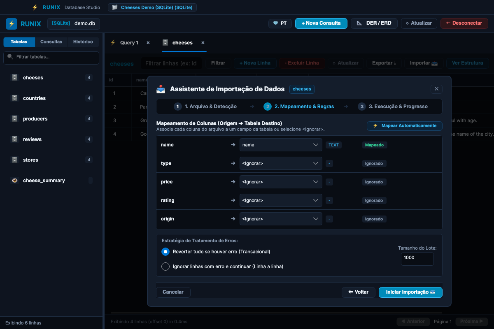
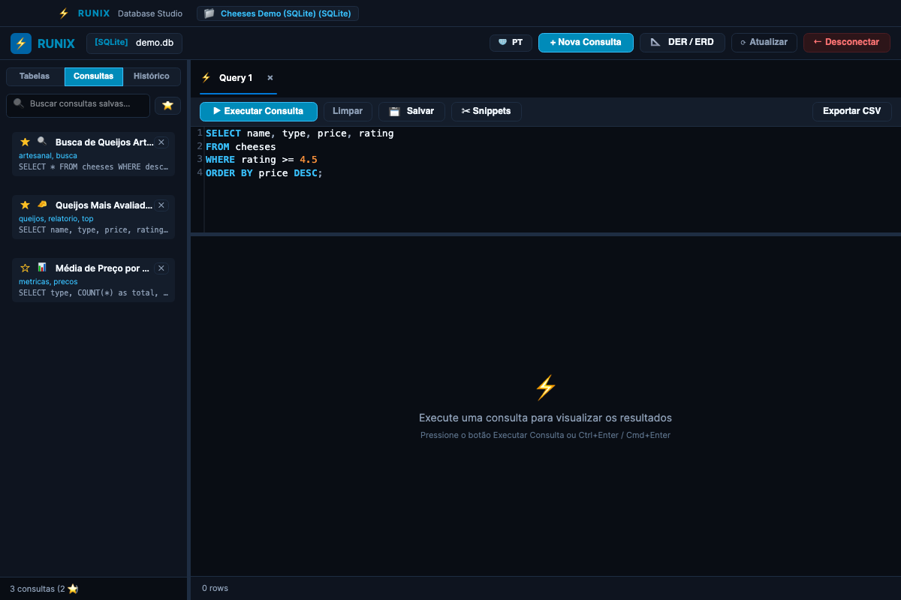
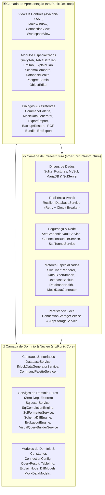

<div align="center">

# ⚡ RUNIX Database Studio

**Estúdio de Bancos de Dados Relacionais Moderno, Multiplataforma (macOS, Linux & Windows) e de Alta Performance**  
*Desenvolvido nativamente com .NET 10, C# 13, Avalonia UI 11 & SkiaSharp — Zero overhead de Electron, 100% offline & privacy-first.*

[](#)
[](#)
[](https://dotnet.microsoft.com/)
[](https://learn.microsoft.com/en-us/dotnet/csharp/)
[](https://avaloniaui.net/)
[](https://www.postgresql.org/)
[](https://www.sqlite.org/)
[](https://www.mysql.com/)
[](https://mariadb.org/)
[](https://www.microsoft.com/sql-server)
[](https://github.com/juniorschroder/vard)
[](#-testes--verificação-headless)

<p align="center">
  <a href="README.md">🇺🇸 English</a> • <strong>🇧🇷 Português (Brasil)</strong>
</p>

</div>

---

## 📖 Sobre o Projeto

O **RUNIX Database Studio** é um cliente desktop **multiplataforma (executando nativamente no macOS, Linux e Windows)**, moderno, veloz e resiliente para inspeção, consulta, administração, geração de dados fictícios e modelagem visual de bancos de dados relacionais (**PostgreSQL**, **SQLite**, **MySQL**, **MariaDB** e **Microsoft SQL Server**).

Projetado sob **Clean Architecture** estrita e renderizado nativamente via **Avalonia UI** e **SkiaSharp**, o RUNIX entrega inicialização instantânea, baixo consumo de memória, tolerância a falhas transitórias de rede com [**Vard**](https://github.com/juniorschroder/vard) (Retry exponencial & Circuit Breaker), criptografia militar **AES-256-GCM** para credenciais e pacotes de compartilhamento (`.rcf`), categorias de conexões com drag-and-drop e suporte bilíngue em tempo real (**Português `pt-BR`** e **Inglês `en-US`**).

---

## ✨ Principais Recursos

### 🔌 Multi-Engine, Conectividade, Segurança & Resiliência
- **Multi-Engine Relacional Amplo:** Suporte nativo de alta performance para **PostgreSQL** (`Npgsql`), **SQLite** (`Microsoft.Data.Sqlite`), **MySQL** (`MySqlConnector`), **MariaDB** (`MySqlConnector`) e **Microsoft SQL Server** (`Microsoft.Data.SqlClient`), além de banco de demonstração embarcado (`demo.db`).
- **Seletor em Dropdown Moderno:** Alternância fluida de motor em dropdown com os logos oficiais vetoriais, configuração automática de portas padrão (`5432`, `3306`, `1433`), opções específicas por dialeto (ex: *Trust Server Certificate* para SQL Server, *Modo SSL* para PostgreSQL) e seletor de arquivo local para SQLite.
- **Categorias Hierárquicas de Conexão:** Agrupamento de perfis em pastas colapsáveis na barra lateral com reordenação via drag-and-drop, gerenciamento inline e badges visuais de ambiente (Produção `🚨 PROD`, Somente-Leitura `🔒 RO`, Túnel SSH `🔐 SSH`).
- **Cofre de Credenciais AES-256-GCM:** Senhas de banco, senhas SSH e passphrases de chaves são criptografadas em repouso (`AesGcm` + derivação `PBKDF2-SHA256` com 100.000 iterações).
- **Pacotes Criptografados (`.rcf`):** Exporte e importe conexões, consultas salvas e snippets em um arquivo `.rcf` protegido por senha mestra para compartilhamento seguro entre equipes ou migração de estação.
- **Túnel SSH Integrado:** Port forwarding nativo em portas locais efêmeras (`127.0.0.1:0`) com autenticação por senha ou chave privada (`.pem`, `id_rsa`, `id_ed25519`).
- **Resiliência com [Vard](https://github.com/juniorschroder/vard):** Camada `ResilientDatabaseService` com políticas automáticas de *Exponential Backoff Retry* e *Circuit Breaker* para todos os motores de rede, evitando travamentos ou perda de abas em quedas transitórias de conexão.

### 💻 Editor SQL Avançado, Autocomplete & Visual Query Builder
- **IntelliSense & Autocomplete Contextual (`< 2ms`):** Analisador léxico in-process (`SqlLexerService`) que sugere palavras-chave ANSI SQL, tabelas, views, colunas resolvidas por alias (`FROM cheeses c` -> `c.`) e snippets customizados (`[KW]`, `[TBL]`, `[COL]`, `[SNP]`).
- **SQL Beautifier In-Process (`Ctrl+Shift+F`):** Formatador léxico que indenta cláusulas SQL complexas preservando literais `'...'`, identificadores `"..."`, comentários e blocos dollar-quoted (`$$...$$`).
- **Visual Query Builder:** Construtor visual interativo com seleção de tabelas/colunas, funções de agregação (`SUM`, `COUNT`, `AVG`, `MIN`, `MAX`), `JOIN`s sugeridos automaticamente via Foreign Keys, filtros `WHERE` e `ORDER BY`.
- **Biblioteca de Queries & Snippets:** Repositório local persistente para consultas favoritas (com tags e busca) e gerenciador de snippets SQL customizados.

### 🎲 Gerador de Mock Data (Massa de Testes)
- **Síntese Inteligente com Consciência de Esquema:** Infere regras automaticamente a partir dos tipos e nomes de colunas (nomes, e-mails, telefones, endereços, datas/horas, sequências incrementais, números aleatórios e formatos customizados).
- **Amostragem de Chaves Estrangeiras (FK):** Coleta e reutiliza chaves válidas de tabelas relacionadas, garantindo integridade referencial sem violações de chave externa.
- **Volumes Customizáveis & Nulos:** Seleção rápida de lotes (10, 25, **50 padrão**, 100, 250, 500, 1.000 linhas) e controle da porcentagem de valores nulos por coluna.
- **Prévia Instantânea & Inserção Direta:** Grade de prévia com 5 registros fictícios em tempo real, seguida de gravação transacional direta no banco ou exportação para script SQL `INSERT INTO`.

### 📐 Editor Visual Bidirecional de DER (Diagrama Entidade-Relacionamento)
- **Modelagem Visual & Introspecção:** Canvas interativo com renderização de curvas Bezier, indicadores de cardinalidade (`1:N`), chaves primárias (`PK`) e estrangeiras (`FK`), zoom, pan e auto-layout.
- **Busca de Entidades (`Ctrl+F`):** Filtro de busca em tempo real no DER para localizar rapidamente tabelas em esquemas densos.
- **Sincronização DDL & Migrações Seguras:** Crie ou altere tabelas, colunas e chaves estrangeiras visualmente no diagrama, visualize o preview do script DDL (`CREATE TABLE`, `ALTER TABLE`) e aplique migrações em lote transacional com rollback automático em caso de erro.
- **Exportação Multi-Formato:** Exporte o diagrama em imagem **PNG** (Retina 2x), documentos **PDF** vetoriais (Ajustar ao Conteúdo, A4 Paisagem, A3 Paisagem) ou scripts **SQL DDL** completos.

### 🗃️ Inspetor e Editor de Objetos do Banco
- **Gerenciamento de Objetos Não-Tabela:** Interface dedicada para inspecionar, auditar e recriar:
  - **Views:** Definição SQL, metadados de colunas e scripts de recriação.
  - **Triggers:** Temporização (`BEFORE`, `AFTER`, `INSTEAD OF`), eventos disparadores e corpo executável.
  - **Índices:** Tipo (Clustered, Non-Clustered, Unique), ordem de colunas e DDL associado.
  - **Funções e Stored Procedures:** Assinaturas de parâmetros, tipo de retorno, dialeto/linguagem e código-fonte.

### 📝 Edição de Dados In-Grid (Stage / Commit) & Inspetor de Registro
- **Edição Transacional com Dirty Tracking:** Edite células diretamente no `DataGrid`, adicione novas linhas ou marque registros para exclusão com destaque semântico de cores (Âmbar para edições, Verde para inserções, Vermelho para exclusões).
- **Preview & Commit Atômico:** Revise todas as alterações pendentes na barra de staging e salve em uma única transação atômica com proteção total contra SQL Injection, ou descarte instantaneamente em memória.
- **Record Inspector Drawer (`JSON` / `TEXT` / `BLOB`):** Painel lateral para inspecionar e editar payloads longos com Pretty-Print/Minify de JSON, visualização de texto multilinha e Hex Dump para binários (`BLOB`).

### 🔍 Command Palette Global (`Ctrl/Cmd+K`) & Busca Transversal de Dados
- **Command Palette (`Ctrl/Cmd+K` / `Ctrl/Cmd+P`):** Busca fuzzy instantânea sobre tabelas, views, triggers, functions, índices, queries salvas, snippets e ações do sistema, com suporte a prefixos (`>`, `#`, `@`, `?`), acrônimos e histórico MRU.
- **Full-Database Data Search:** Varredura assíncrona em todas as tabelas do banco de dados simultaneamente com cancelamento seguro, contagem de ocorrências por tabela e salto direto para os registros encontrados.

### 📊 Visual Explain Plan, Quick Charts & DBA Suite
- **Visual Explain Plan & Profiler:** Árvore visual de execução para PostgreSQL (`EXPLAIN (ANALYZE, BUFFERS, FORMAT JSON)`) e SQLite (`EXPLAIN QUERY PLAN`), com mapa de calor de custos e motor heurístico de recomendação de índices (`CREATE INDEX`).
- **Gráficos Nativos em SkiaSharp:** Transforme qualquer resultado de query em gráficos de **Barras Verticais**, **Barras Horizontais**, **Linhas/Área**, **Dispersão (Scatter)** ou **Donut/Pizza**, com agregação automática e exportação para **PNG Retina 2x** e **SVG**.
- **Schema Compare & Diff Tool:** Compare dois bancos de dados ativos ou snapshots de schema lado a lado e gere scripts DDL de sincronização com modo seguro.
- **Dashboard de Saúde & Manutenção Assistida:** Telemetria em tempo real (Cache Hit Ratio, tamanho de tabelas vs. índices, Dead Tuples, páginas/freelist SQLite), detecção de índices redundantes ou não utilizados, e execução assistida de `VACUUM`, `ANALYZE`, `REINDEX` e `PRAGMA integrity_check`.
- **Administração PostgreSQL:** Gerenciador visual de Roles/Usuários, Matriz de Privilégios (`GRANT`/`REVOKE`) e Monitor de Sessões Ativas (`pg_stat_activity` com `pg_terminate_backend`).
- **Importação, Exportação & Backup/Restore:** Exportação streaming para **CSV**, **JSON**, **Excel (`.xlsx`)** e **SQL Dump**; Assistente de Importação em 3 passos com auto-mapeamento de colunas; e Backup/Restore nativo (`.sql`, `.sql.gz`, `.db`) com ordenação topológica de chaves estrangeiras.

---

## 🖼️ Screenshots

### Workspace Principal & Árvore de Esquema Hierárquica


### Tela de Conexões (PostgreSQL, SQLite, MySQL, MariaDB, SQL Server & Pacotes `.rcf`)


### Diagrama Entidade-Relacionamento (DER) Interativo & Modelagem Visual
| Diagrama DER Completo | Modelagem Visual de Tabela no DER |
| :---: | :---: |
|  |  |

| Preview de Migração DDL no DER | Comparador de Schemas (Schema Diff & Sync) |
| :---: | :---: |
|  |  |

### Produtividade SQL, Edição In-Grid & Gráficos Nativos
| Autocomplete SQL Contextual (`IntelliSense`) | Edição In-Grid com Staging (`Dirty Tracking`) |
| :---: | :---: |
|  |  |

| Gráficos Nativos SkiaSharp (`Quick Charts`) | Visual Explain Plan & Recomendação de Índices |
| :---: | :---: |
|  |  |

### Administração DBA, Importação & Exportação
| Suite de Administração PostgreSQL (Roles, Privilégios & Sessões) | Assistente de Importação CSV/Excel |
| :---: | :---: |
|  |  |

| Exportador Multi-Formato (CSV, JSON, XLSX, SQL) | Biblioteca de Queries Salvas & Histórico |
| :---: | :---: |
|  |  |

---

## 🏗️ Arquitetura do Projeto

O projeto segue rigorosamente os princípios da **Clean Architecture**, garantindo separação de responsabilidades, testabilidade isolada e dependências estritamente unidirecionais voltadas para o domínio (`Runix.Desktop -> Runix.Infrastructure -> Runix.Core`).



### Estrutura de Diretórios

```text
├── Runix.sln                          # Solution principal (.NET 10)
├── src/
│   ├── Runix.Core/                    # Domínio puro: Modelos, Interfaces, Lexer SQL, Diff Engine, Layout DER, Modelos Mock Data
│   ├── Runix.Infrastructure/          # Implementações: SQLite, PostgreSQL, MySQL, MariaDB, SQL Server, Vard Resilience, AES-256-GCM, SkiaSharp, MiniExcel
│   └── Runix.Desktop/                 # Aplicação Desktop Avalonia UI 11.1, XAML Views, Temas e Localização (pt-BR / en-US)
├── tests/
│   ├── Runix.Core.Tests/              # Testes unitários de domínio, parsers, formatadores e motores de cálculo (305 testes)
│   └── Runix.Infrastructure.Tests/    # Testes de integração de drivers, criptografia, backup/restore, import/export e resiliência (182 testes)
└── Screenshots/                       # Capturas de tela geradas via pipeline Headless Skia
```

---

## 🛠️ Tech Stack

| Categoria | Tecnologia | Versão | Papel no RUNIX |
| :--- | :--- | :--- | :--- |
| **Linguagem & Runtime** | **C# 13 / .NET** | `10.0` | Runtime multiplataforma (`osx-arm64`, `osx-x64`, `linux-x64`, `win-x64`) |
| **Interface Gráfica** | **Avalonia UI** | `11.1.0` | Framework UI nativo multiplataforma com XAML compilado e tema Fluent Dark |
| **Editor de Código** | **AvaloniaEdit** | `11.1.0` | Editor de texto de alta performance com syntax highlighting SQL customizado (`.xshd`) |
| **Motor Gráfico 2D & PDF** | **SkiaSharp** | `2.88.8` | Renderização vetorial de gráficos analíticos, canvas DER, exportação PDF e capturas headless |
| **Driver PostgreSQL** | **Npgsql** | `10.0.3` | Provedor ADO.NET assíncrono de alta performance para PostgreSQL |
| **Driver SQLite** | **Microsoft.Data.Sqlite** | `11.0.0` | Provedor ADO.NET para bancos SQLite locais e catálogo interno da aplicação |
| **Driver MySQL & MariaDB** | **MySqlConnector** | `2.4.0` | Provedor ADO.NET assíncrono de alta performance para MySQL e MariaDB |
| **Driver SQL Server** | **Microsoft.Data.SqlClient** | `6.0.2` | Provedor oficial da Microsoft para SQL Server e Azure SQL |
| **Resiliência** | [**Vard**](https://github.com/juniorschroder/vard) | `1.0.0` | Políticas de tolerância a falhas transitórias (*Retry* exponencial e *Circuit Breaker*) |
| **Planilhas Excel** | **MiniExcel** | `1.47.0` | Leitura e escrita de arquivos `.xlsx` via streaming com baixo uso de memória |
| **Criptografia** | **System.Security.Cryptography** | Nativo | `AesGcm` (256-bit) + `Rfc2898DeriveBytes.Pbkdf2` (SHA-256) para cofre e pacotes `.rcf` |
| **Testes** | **xUnit + FluentAssertions** | `2.9.x` | Suíte automatizada com **487 testes aprovados** (unitários e de integração) |

---

## 🚀 Como Executar

### Pré-requisitos
- [.NET 10.0 SDK](https://dotnet.microsoft.com/download/dotnet/10.0) instalado (macOS, Linux ou Windows).

### 1. Clonar e Compilar
```bash
git clone https://github.com/juniorschroder/runix.git
cd runix

dotnet build Runix.sln
```

### 2. Iniciar a Aplicação
```bash
# Iniciar na tela de gerenciamento de conexões
dotnet run --project src/Runix.Desktop/Runix.Desktop.csproj

# Ou iniciar conectando automaticamente ao banco SQLite de demonstração (demo.db)
dotnet run --project src/Runix.Desktop/Runix.Desktop.csproj -- --demo
```

### 3. Gerar Executável Standalone (Release)
```bash
dotnet publish src/Runix.Desktop/Runix.Desktop.csproj -c Release -o ./publish
```

---

## 🧪 Testes & Verificação Headless

O RUNIX conta com **487 testes automatizados** (divididos entre `Runix.Core.Tests` e `Runix.Infrastructure.Tests`) que validam analisador léxico SQL, motores multi-engine, gerador de dados mock, migrações DDL, criptografia AES-256-GCM e o pipeline de resiliência [Vard](https://github.com/juniorschroder/vard):

```bash
dotnet test Runix.sln
```

Além disso, a aplicação possui um modo de renderização **Headless via Skia** (`Avalonia.Headless`), permitindo capturar screenshots reais da interface em ambientes de CI/CD ou terminais sem servidor gráfico:

```bash
dotnet run --project src/Runix.Desktop/Runix.Desktop.csproj -- --demo --screenshot ./Screenshots/preview.png
```

---

## ⌨️ Atalhos de Teclado Principais

| Atalho | Ação |
| :--- | :--- |
| `Ctrl+K` / `Cmd+K` ou `Ctrl+P` / `Cmd+P` | Abrir a **Command Palette Global** (busca fuzzy de tabelas, views, ações e queries) |
| `Ctrl+Enter` / `Cmd+Enter` ou `F5` | Executar a consulta SQL na aba ativa |
| `Ctrl+Shift+F` | Formatar e indentar o código SQL automaticamente (**SQL Beautifier**) |
| `Ctrl+Space` | Forçar abertura do popup de **Autocomplete / IntelliSense SQL** |
| `Ctrl+F` | Localizar dados na tabela / Filtrar entidades no diagrama DER ativo |
| `Esc` | Fechar popups de autocomplete, modais ou painéis laterais |

---

## 👨‍💻 Criador & Autor

Criado e arquitetado por **José Carlos Schröder Júnior**.

## 📄 Licença

Distribuído sob a licença GNU General Public License v3.0 (GPL-3.0). Veja o arquivo [LICENSE](LICENSE) para mais detalhes.
